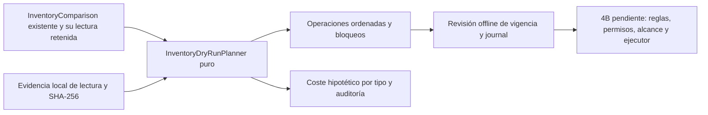

# PASO 4A — Preparación segura de la sincronización

**Estado: Dry Run implementado y probado; ejecución de producción no implementada ni autorizada.** El botón de sincronización sigue deshabilitado. No se avanzó al paso 4B.

## 1. Inspección y arquitectura

Se revisaron `security/audit-2026-10-21/AUDITORIA.md`, la copia descargada de reglas, los modelos del lector y comparador, la vista previa y el guardado de SALIDA. No se volvió a descargar inventario ni se accedió a Firebase de producción. Las conclusiones de permisos se refieren a la copia auditada, no a una certificación de una versión remota posterior.



El generador no recibe FirebaseFirestore, FirebaseAuth, credenciales ni callbacks de ejecución. No tiene método apply/commit. Solo consume el resultado existente y evidencia local; tampoco vuelve a ejecutar el comparador. `productionExecutable` y `destructiveEligible` son propiedades calculadas siempre falsas: no se pueden activar mediante constructor o `copy`.

La implementación se entrega como API local y pruebas, **sin conectar un nuevo botón a la interfaz**, sin modificar las pantallas aprobadas ni las consultas del paso 2.

## 2. Archivos creados

En `app/src/main/java/com/example/app_clisa/data/excel/`:

- `SyncPlan.kt`: tipos de operaciones, validación/riesgo, evidencia, checks y estimador.
- `InventoryDryRunPlanner.kt`: generador determinista sin efectos secundarios.
- `SyncPlanIdentity.kt`: huella de archivo, canonicalización, fingerprint del inventario, revisión de cambios y ventana de antigüedad.
- `SyncRecoveryReview.kt`: revisión local de journal y clave de repetición por origen/política.

En `app/src/test/java/com/example/app_clisa/`:

- `InventoryDryRunPlannerTest.kt`: pruebas del plan, integridad, cuotas, vigencia, recuperación y Excel real local.
- `ImportRulesAuditTest.kt`: detección estática de las contradicciones conocidas de la copia de reglas.

Documentación:

- `security/paso4a/REVISION-Y-PROPUESTA.md`: revisión y contrato de seguridad propuesto, sin ruleset desplegable.
- Este informe y `validacion-excel-real.txt`, generado exclusivamente por una prueba local.

No se modificaron el lector, `InventoryComparison.kt`, `FirestoreInventoryReader.kt`, el coordinador de importación, la vista previa, Gestión de Productos, Detalle de producto, reglas, índices o configuración Firebase. No se añadieron dependencias.

## 3. Generador de plan

Uso local con resultados que ya existen en memoria:

```kotlin
// sha se obtiene de los mismos bytes que se leen, no del nombre del archivo.
val evidence = ReportReadEvidence.fromReadResult(excel, fileName, sha)
val plan = InventoryDryRunPlanner.generate(comparison, evidence)
// Inspeccionar plan.operations, plan.checks y plan.cost. No hay ejecución.
```

`SyncPlanIdentity.fileSha256(InputStream)` permite preparar esa huella local. La interfaz actual no la conserva automáticamente: esa conexión y la procedencia verificable del archivo deberán aprobarse/prepararse antes de 4B. Omitir evidencia genera bloqueos; nunca equivale a validación correcta. No se inventó una huella a partir del nombre del archivo.

Cada operación conserva: identificador determinista, tipo, colección, ruta/ID reales cuando existen, SKU, serie, ID del producto relacionado, campos anteriores/esperados, motivo, validación, riesgo, bloqueos, referencias de origen, grupo atómico propuesto y versión observada.

| Tipo | Significado y protección |
|---|---|
| CREATE_PRODUCT | Producto nuevo por SKU. Ruta e ID nulos hasta aprobar política de IDs/esquema; no se cambia `/` por `_`. |
| CREATE_EXISTENCE | Nueva serie. Conserva el productoId existente o lo deja pendiente si también es nuevo. No inventa existenciaId. |
| UPDATE_EXISTENCE | Diferencia de cantidad individual; muestra cantidad/estado anterior y esperado, con ruta real. |
| DELETE_EXISTENCE | Candidata ausente; **siempre bloqueada** por alcance no demostrado, reglas actuales y posibles referencias históricas. No se convierte en cantidad 0. |
| UPDATE_PRODUCT_STOCK | Cambio de stock esperado del Excel; no incluye cantidadRestante. Debe conciliar todas las series del grupo. |
| SKIP_UNCHANGED | Serie/cantidad sin cambio o stock conciliado; cero escrituras. Un skip de stock no implica que todo el producto carezca de otras diferencias. |
| BLOCK_CONFLICT | Duplicado, inconsistencia, evidencia ausente o decisión pendiente; conserva todas las referencias. |
| REVIEW_MISSING_PRODUCT | Producto ausente del Excel, conservado para revisión, sin borrado ni stock cero automático. |

Las operaciones tienen estados CANDIDATE, REVIEW_REQUIRED, BLOCKED o SKIPPED. CANDIDATE significa únicamente que superó las comprobaciones locales disponibles: **no es autorización de escritura ni garantiza compatibilidad con las reglas publicadas**. Si una operación de inventario de un grupo está bloqueada, sus otras mutaciones también se bloquean para no proponer un stock aislado incoherente. Varias mutaciones sobre una misma ruta se marcan con MULTIPLE_OPERATIONS_SAME_PATH, sin elegir una arbitrariamente.

La canonicalización codifica tipos y longitudes, ordena mapas, referencias y operaciones, conserva espacios/ceros originales y genera SHA-256. Ordenar de otra manera los documentos leídos no cambia el contenido del plan ni su ID. La huella incluye el contenido observado, no el orden ni los tiempos de inicio/fin de una página. Generar un plan repetidamente no crea recursos ni acumula operaciones.

## 4. Reporte completo y conflictos

Se verifican por separado: huella del origen, lectura XLSX correcta, columnas, encabezados, separación de resúmenes, errores críticos, filas relevantes sin interpretar, lectura base completa e identidades/referencias inequívocas. Los duplicados del resultado se mantienen como conflictos, y además se revisan las identidades de la lectura retenida.

La fábrica de evidencia no afirma un recuento de filas no interpretadas que el lector no expone: lo deja desconocido. Si hay incidencias tampoco certifica automáticamente todas las columnas. Estas limitaciones bloquean los cambios propuestos hasta una revisión más completa. Los fallos del lector y los conflictos globales invalidan las mutaciones; no se importa silenciosamente solo una fracción reconocida del archivo.

**No existe prueba fiable de exportación completa en los modelos actuales.** Un booleano, un nombre, una declaración del operador o que coincidan cantidades de filas no bastan. FULL_REPORT_PROVEN permanece pendiente, aunque declaredScope diga “completo”. Para habilitar bajas en otra etapa harían falta una política y procedencia verificables, por ejemplo un manifiesto del sistema origen vinculado a la huella, tienda, fecha de corte, ausencia de filtros y recuentos/totales de control. No se implementó una certificación ficticia.

Ejemplo cubierto por pruebas, con stock total idéntico:

| Documento/serie | Antes | Excel | Operación |
|---|---:|---:|---|
| Serie 001 | 1 | ausente | DELETE_EXISTENCE, bloqueada |
| Serie NEW | no existe | 1 | CREATE_EXISTENCE, ID pendiente y bloqueada |
| productos/SKU_1, código SKU/1 | 1 | 1 | No UPDATE_PRODUCT_STOCK por esa sustitución |

No se fusionan productos por nombre ni se escoge el primer duplicado. Los SKU ambiguos no se convierten en IDs nuevos. Los grupos sin código siguen siendo un bloqueo del origen, no una señal para retirar masivamente lo que no pudo identificarse.

El Excel real conserva las incidencias auditadas: 1 814 grupos, 22 762 filas de serie, 346 grupos sin SKU y 567 incidencias del lector. `validacion-excel-real.txt` muestra el resultado de probar el generador frente a un inventario **vacío ficticio**: no representa las diferencias actuales contra producción y no sirve para estimar cuánto cambiaría realmente esa base.

## 5. Stock, catálogos e historial

- `ProductCatalog.kt` usa productos.stock para filtros, cantidades y contadores.
- `FirestoreInventory.kt.save` registra SALIDA y descuenta productos.stock y existencias.cantidad en una transacción, con cantidades positivas, stock suficiente, receptor TOQEN y validaciones de usuario/tiendas.
- Esa transacción no descuenta cantidadRestante/cantidadTotal/cantidadLotes. La auditoría encontró stock=0 y cantidadRestante=1 después de una SALIDA; no deben equipararse.
- En Android no se encontró un ejecutor de AJUSTE; el contrato de las reglas exige ajustes relacionados con stock/existencia y un registro, pero tiene las contradicciones descritas en la revisión de seguridad.
- El plan suma cantidades de series, no números entre paréntesis ni filas de resumen. Cantidades negativas, nulas o con desbordamiento quedan bloqueadas.
- cantidadRestante aparece solo como dato observado/decisión pendiente. No se incluye en los campos esperados de ninguna mutación. No hay actualización automática de los contadores heredados.
- productoId apunta al ID real; codigoProducto conserva el SKU y codigo es la serie. categorias/marcas usan sus IDs existentes. Este plan no modifica esos catálogos ni las referencias de productos existentes; tampoco clasifica productos nuevos.
- No existe operación dirigida a registros. Sus IDs, campos y referencias históricas permanecen intactos. No se proponen reemplazos completos de productos que eliminen metadatos existentes.

## 6. Vigencia, auditoría y recuperación propuestas

### Precondiciones

`SyncPlanFreshness.validate` compara la huella del archivo y la lectura completa suministrada con el fingerprint del plan. Detecta cambios de cantidades, versiones, relaciones y miembros del inventario, incluidas series nuevas. No consulta el servidor ni decide que un snapshot suministrado sea auténtico o reciente. `reviewAge` añade una ventana configurable y detecta falta de fecha, caducidad o retroceso de reloj; esa ventana no certifica el alcance del Excel.

Los fingerprints abarcan los campos de los modelos actuales. `actualizadoEn` es una versión observada de aplicación, no el updateTime nativo de Firestore. Si falta una versión se bloquea la mutación existente. Antes de 4B harán falta lecturas/precondiciones auténticas en el commit y, según la política de concurrencia, una revisión/cerrojo común para todos los escritores. Releer antes y escribir después sin transacción deja una carrera. Una lectura paginada tampoco es una instantánea global atómica.

### Contrato de auditoría propuesto, sin crear documentos

Utilizar la raíz existente importaciones con un contrato nuevo aprobado; no se crearon documentos ni subcolecciones:

- Job: importacionId, planId, versión de política, UID responsable, timestamps de servidor, archivo/nombre/tamaño, SHA-256, alcance y fecha de corte verificados, fingerprint base, estimación y contadores confirmados, estado y errores.
- Estados: PLANNED → VALIDATED → APPLYING → COMPLETED; alternativas PARTIAL, FAILED, CANCELLED. COMPLETED solo tras conciliar todas las unidades confirmadas.
- Journal por operación: operationId, tipo, ruta, SKU/serie, precondición/versión, before/after completos necesarios para recuperación, usuario/fecha y resultado. Un fallo es un intento separado, no un APPLIED ficticio.
- Checkpoint por unidad de producto: lista/hash de operaciones, contadores de éxito y versión posterior. Cambios de inventario, journal y checkpoint deben confirmarse en la misma unidad atómica cuando sea viable.

Las listas extensas no caben necesariamente en un documento; distribuirlas en registros acotados después de aprobar esquema/reglas. Los campos before del plan actual son diferencias observadas, **no una copia completa recuperable de un documento eliminado**. Una baja física necesitaría además backup completo y política de referencias históricas; por eso permanece bloqueada.

### Repeticiones y estado parcial

El planId identifica fuente, baseline, checks y operaciones. `sourceReplayKey` identifica los mismos bytes de origen, alcance y política independientemente de un baseline que haya cambiado. Un job futuro debe reservar esa clave de forma atómica; el nombre del archivo no es idempotencia. Un XLSX guardado otra vez puede cambiar bytes sin cambiar datos: hará falta también identidad de exportación/manifiesto o huella semántica verificada antes de autorizar reimportaciones.

`SyncRecoveryReview` examina un journal suministrado localmente. Rechaza identidad incorrecta, operaciones desconocidas, entradas duplicadas y APPLIED sin prueba posterior. No toma la primera entrada duplicada ni reintenta a ciegas una operación ya aplicada; clasifica pendientes/fallidas y bloquea la continuación automática cuando hay aplicación parcial. Esto no es todavía una validación criptográfica de un journal de servidor ni un ejecutor.

Un fallo posterior a algunos commits exige mostrar PARTIAL, conciliar el journal y revalidar antes de continuar. No marcar COMPLETADO por llegar al final de un bucle. Una recuperación no debe restaurar cantidades antiguas sobre traspasos legítimos posteriores: comparar versiones y realizar compensaciones nuevas auditadas, conservando el historial. La atomicidad de todo el archivo requiere otro diseño; no se promete con commits por lotes.

## 7. Reglas y alternativa Spark

La revisión detallada está en [REVISION-Y-PROPUESTA.md](../../security/paso4a/REVISION-Y-PROPUESTA.md). Se detectan SALIDA/estadoPago, AJUSTE/hasAll/hasOnly, esquema mínimo de producto, creación de existencia insuficientemente validada, borrado prohibido, reutilización potencial de registros y resumen COMPLETADO inmutable.

No se preparó un ruleset genérico para copiar: el contrato de sincronización depende de decisiones pendientes. No se modificaron ni desplegaron reglas. Los tests estáticos confirman la detección de bloqueos, no el funcionamiento de una política segura. No se ejecutó Firebase Emulator de reglas; antes de 4B habrá que probar las reglas aprobadas con roles, cuentas bloqueadas, replay, commits parciales y concurrencia.

Spark permite plantear un cliente con reglas estrictas y unidades pequeñas o una herramienta de operador de confianza fuera de Android. El segundo enfoque usa IAM y necesita validaciones propias porque las reglas cliente no lo protegen; no elimina cuotas ni límites. Ninguna credencial administrativa debe entrar en Android. Cloud Functions desplegadas requieren Blaze, como indica la [documentación oficial](https://firebase.google.com/docs/functions/get-started). No se habilitó facturación ni se implementó un backend.

## 8. Consumo estimado

El Dry Run realiza **0 lecturas, 0 escrituras y 0 eliminaciones de Firestore**. Trabaja con los documentos ya leídos. El estimador separa:

- Operaciones por tipo y escrituras potenciales CREATE_PRODUCT/CREATE_EXISTENCE/UPDATE_EXISTENCE/UPDATE_PRODUCT_STOCK.
- Eliminaciones potenciales, aunque todas están bloqueadas; eliminaciones autorizadas: cero.
- Auditoría hipotética mínima: si hay cambios, 2 escrituras de job (inicio/final) + 1 registro por mutación, incluyendo bajas + 1 checkpoint por grupo. Si no hay cambios: cero. Fallos, reintentos, backups, bloqueos, versiones y progreso adicional podrían aumentar el coste.
- Lectura de comparación ya realizada, posible revalidación completa futura y mínimo de lecturas de destinos conocidos/productos afectados. No hay total exacto para IDs pendientes, llamadas dependientes de reglas o reintentos.

La estimación incluye las propuestas bloqueadas como **escenario hipotético**, no como presupuesto de ejecución autorizado. Por ello puede ser mayor que la estimación parcial de la vista previa del paso 3, que excluía propuestas sin resolver. Los documentos SKIP_UNCHANGED no cuentan como escrituras.

| Escenario hipotético | Inventario | Auditoría mínima | Total escrituras | Eliminaciones |
|---|---:|---:|---:|---:|
| Todo sin cambios | 0 | 0 | 0 | 0 |
| Crear una serie y retirar otra, mismo producto/stock | 1 | 5 | 6 | 1 bloqueada |
| 500 series actualizadas + 200 stocks, 200 grupos | 700 | 902 | 1 602 | 0 |
| Actualizar 22 762 series + 1 799 productos | 24 561 | 26 362 | 50 923 | 0 |

Con el tamaño auditado, una comparación completa cuenta aproximadamente 24 561 documentos más validaciones. Una revalidación completa futura duplicaría ese componente a 49 122; las lecturas de commits, reglas y uso del resto de la app pueden agotar el margen. No se consulta la cuota restante ni se garantiza que alcance.

Se marcan escenarios que exceden las cuotas diarias completas de referencia: 50 000 lecturas, 20 000 escrituras o 20 000 eliminaciones. Estar por debajo no significa tener ese saldo disponible. También deben revisarse transferencia/almacenamiento. Límites y cuotas: [Firebase](https://firebase.google.com/docs/firestore/quotas). Las unidades atómicas deben respetar tamaño, tiempo y accesos de reglas; [transacciones](https://firebase.google.com/docs/firestore/manage-data/transactions).

## 9. Pruebas y reproducción

Las pruebas cubren los 15 escenarios pedidos: producto/serie nuevos, cantidad diferente, ausencia, mismo stock con otra serie, duplicados, SKU distinto del ID, producto ausente, origen incompleto, filas desconocidas, conflictos, determinismo/repetición, datos modificados, costes/cuotas e historial protegido. Añaden versiones ausentes, reloj/caducidad, operaciones repetidas por ruta, bloqueo del grupo, journal incorrecto/parcial, separación de cantidadRestante y el Excel real local.

Los fixtures son objetos JUnit en memoria. La prueba del Excel real utiliza una lectura base vacía ficticia; no consulta Firestore ni crea usuarios/datos de prueba en producción. Las pruebas de UI existentes no se modificaron: el diseño permanece intacto.

Validación ejecutada: compilación Debug correcta y **157 pruebas unitarias aprobadas, cero fallos y cero omitidas**. Incluyen 27 pruebas nuevas de planificación/recuperación/archivo real y 5 pruebas estáticas de la copia de reglas. No se ejecutaron pruebas de reglas en Firebase Emulator ni se ensayó un ejecutor de sincronización. La prueba local del Excel produjo 659 operaciones diagnósticas BLOCK_CONFLICT y todas sus mutaciones propuestas bloqueadas; los recuentos del inventario ficticio no son un delta de producción.

```powershell
$env:JAVA_HOME = 'C:\Program Files\Android\Android Studio1\jbr'
$env:CLISA_EXCEL_SAMPLE = 'C:\Users\TUF\Documents\stock.production.lot123 - 2000.xlsx'
$env:CLISA_DRY_RUN_REPORT = 'C:\Users\TUF\AndroidStudioProjects\appclisa\docs\importacion-paso4a\validacion-excel-real.txt'
.\gradlew.bat :app:assembleDebug :app:testDebugUnitTest --no-configuration-cache
```

## 10. Decisiones pendientes antes de 4B

1. Cómo demostrar procedencia, alcance completo y fecha de corte de la exportación; distinguir datos parciales o demasiado antiguos.
2. Si las ausencias se resuelven con baja lógica o alguna excepción de borrado físico respaldada, protegiendo el historial.
3. Semántica de cantidadRestante/cantidadTotal/cantidadLotes y política de reactivación de series ya traspasadas.
4. Política de IDs nuevos, esquema de productos/existencias y referencias/clasificación sin inventar categorías o marcas.
5. Reglas corregidas, contrato del job/journal y pruebas funcionales de seguridad en emulador.
6. Ejecutor: cliente con reglas estrictas o componente privilegiado externo. Ninguno existe en 4A.
7. Concurrencia con SALIDA/AJUSTE y garantías aceptadas: por producto con estado parcial visible o publicación global versionada.
8. Presupuesto, revalidación, tamaños de unidad, recuperación y autorización de un plan concreto antes de escribir.

**Producción no se modificó: no se crearon/actualizaron/borraron documentos, no se tocaron traspasos históricos, no se desplegaron reglas/índices, no se cambiaron roles y no se habilitó sincronización o IA.**
