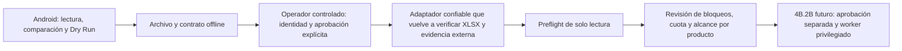

# PASO 4B.2A — Preparación para sincronización supervisada

Fecha: 23 de octubre de 2026, America/Lima. **Resultado: preparación y preflight de solo lectura implementados; ejecución real BLOQUEADA. No se avanzó a 4B.2B.**

## 1. Estado real del motor 4B.1

Se revisaron el informe y el código reales de 4B.1, los informes 4A/4A.1/4A.2 y formalización, el contrato Kotlin, su generador, la transacción SALIDA, reglas publicadas y propuestas locales. El resumen del paso anterior no se tomó como prueba de funcionalidades inexistentes.

| Requisito | Estado | Evidencia y límite |
|---|---|---|
| Plan/operaciones versionados y hashes | IMPLEMENTADO / PROBADO | Wire 1, Dry Run 3, SHA-256 del archivo, huella semántica de baseline y canonicalización Kotlin/Node. |
| Transporte Android → operador | PENDIENTE | API de exportación offline y CLI local. No hay envío desde Android ni servidor autenticado. |
| Autorización | PROBADO en Emulator; PENDIENTE para ejecución real | Firma de aprobación de fixtures, perfil ACTIVO y claims. El hash no prueba que las filas JSON representen el XLSX recibido; falta adaptador confiable de fuente. |
| Cerrojo, fencing, stock/series y journal atómicos por producto | IMPLEMENTADO / PROBADO en Emulator | No se promete atomicidad del Excel completo. |
| Revalidación | IMPLEMENTADO / PROBADO en Emulator | Pasada global acotada, IDs y unicidad, versiones nativas, consultas por producto y reconciliación atestada solo por fixtures. |
| Auditoría e idempotencia | IMPLEMENTADO / PROBADO | Reserva de fuente, journal/checkpoint en el commit, repetición del mismo run sin reescribir inventario. |
| Recuperación | IMPLEMENTADO / PROBADO con límites | Supervisada, máximo 2 recuperaciones, 3 intentos SDK por transacción; bloqueo retenido tras fallo/revisión. Se reforzó el alcance inmutable. |
| Producción | BLOQUEADO | El runtime sigue aceptando únicamente demo-clisa-sync-4b1 y endpoints locales; no existe factory administrativa de escritura para empresa-clisa. |
| Botón real, reglas/índices, IA | BLOQUEADO / sin activación | Sin cambios de interfaz ni despliegue. |

Los controles de 4B.1 se conservaron; no se sustituyó el motor ni se relajó su modo exclusivo de Emulator.

## 2. Arquitectura propuesta para producción



En **este paso** solo se ejecuta E y se preparan C/D/F. G no existe como conexión de escritura a producción. Se mantienen procesos separados: el inspector REST de solo lectura no importa Firebase Admin SDK ni InventorySyncEngine; el worker existente no puede seleccionar empresa-clisa.

Un uso futuro desde el teléfono requiere transporte autenticado, verificación del ID token y revocación del solicitante, aprobación de un plan concreto, custodia de claves y ejecución administrativa controlada. El UID declarado en JSON y tener Firebase CLI autenticado no resuelven esos requisitos. No se añadió una conexión insegura para activar el botón.

Una estación administrativa puede ser compatible con Spark sin Cloud Functions ni Blaze, pero usar Admin SDK **no elimina cuotas ni valida el negocio automáticamente**. Antes de un worker real se necesita aprobar la identidad de ejecución, el ámbito IAM, el protocolo de mantenimiento y el adaptador del sistema principal. No se crearon cuentas de servicio, claves privadas ni credenciales nuevas.

## 3. Preflight real de solo lectura

Evidencia principal: [production-preflight-final/preflight.json](production-preflight-final/preflight.json), [preflight-final.log](preflight-final.log) y [reglas descargadas](production-preflight-final/deployed-0.rules).

### Qué se comprobó

| Revisión | Estado | Resultado observado |
|---|---|---|
| Proyecto y base | PROBADO | empresa-clisa, `(default)`, FIRESTORE_NATIVE, ubicación nam5, concurrencia PESSIMISTIC. Otro proyecto se rechaza antes de iniciar solicitudes. |
| Identidad de la sesión CLI | PROBADO | OAuth userinfo con email verificado, coincidente con la cuenta seleccionada. Identidad exacta guardada localmente en el informe, sin tokens. |
| Permisos IAM de lectura | PROBADO | testIamPermissions devolvió los permisos requeridos para las inspecciones y consultas acotadas. |
| Permisos futuros de escritura | PENDIENTE | El test devolvió get/create/update requeridos, pero no se intentó escribir ni se certifica cada recurso/condición. No equivale a autorización de sincronización. |
| Rol CLISA del operador | PROBADO | Una coincidencia exacta por email en usuarios, documento propio ACTIVO, rol SUPER_ADMIN y claims coherentes en Auth. No se listó toda la colección usuarios. |
| Reglas publicadas | PROBADO | Ruleset `27e24b85-2698-435c-9949-e5daa2a4abce`, SHA-256 `41f7aadf06df0e4d5b8e89af1fb4ae6f484c9cd57aec3fd6dc553b35ea33451a`. Incluye formalización reciente. |
| Protocolo de importación publicado | BLOQUEADO | Las reglas no coinciden con la propuesta probada de cerrojo 4B.1. No se reemplazaron por reglas antiguas de 4A.1. |
| Índice compuesto | PROBADO | productos: categoriaId ASC + stock ASC + __name__ ASC, COLLECTION, READY. |
| Índices simples | PROBADO como metadatos | Configuración predeterminada ASC/DESC/CONTAINS READY; una entrada general observada. Las consultas exactas de la inspección funcionaron; esto no prueba cualquier consulta futura. |
| Colecciones requeridas | PROBADO por metadatos | productos, existencias, registros, usuarios, tiendas, categorias y marcas aparecen en listCollectionIds. |
| Control de importación | PROBADO por lectura puntual | importaciones/_control_clisa no existe en el instante observado; no se creó. Su ausencia no sustituye el protocolo de exclusión. |
| Compatibilidad del esquema | PROBADO solo para muestras / PENDIENTE global | 2 productos, 2 existencias, 3 registros, 2 tiendas, 1 categoría y 1 marca; sin incompatibilidad detectada por el validador acotado. No se extrapola a toda la base. |
| Históricos/formalización | PROBADO solo para muestras | 2 COMPLETADO y 1 PENDIENTE. SIN_VERIFICAR y variantes antes/después de confirmación se prueban con fixtures; no se presume su ausencia global. Ningún estado acredita inclusión en un Excel. |
| Identidades | PROBADO solo para muestras | Búsquedas exactas por los 2 SKU y 2 series leídos devolvieron una coincidencia cada una. No se acreditan todos los IDs nuevos, referencias o duplicados del inventario. |
| Saldo de cuota, fuente y conciliación | BLOQUEADO | No hay saldo restante verificado, autoridad real del XLSX ni comprobantes externos de inclusión de movimientos. |

### Consumo, parada y límites

- Inspección final: **21 solicitudes HTTP**, **16 resultados documentales devueltos** y **22 unidades de lectura documental reservadas**, con techo de 24. Las coincidencias repetidas se cuentan nuevamente; no son 16 documentos necesariamente distintos.
- No hubo agregaciones de inventario, listeners, paginación de productos/existencias ni escaneo de las 22 762 series.
- Las consultas usan proyecciones y límites de 1–3. Las comprobaciones de duplicados usan igualdad exacta y limit(2). Usuarios se consulta solo por email exacto del operador, limit(2); una coincidencia ambigua detiene la inspección.
- El punto de control se consulta directamente. Un control bloqueado o mal formado detiene el preflight y nunca se intenta liberarlo.
- Cualquier fallo de identidad, permisos de lectura, proyecto, consulta o vínculo perfil/Auth detiene nuevas lecturas remotas. No hay reintento ilimitado, selección de otra cuenta ni fallback de permisos.
- La ausencia de requisitos para **ejecutar** —cuota, evidencia, cerrojo publicado— se informa como bloqueo, aunque hayan terminado las inspecciones de solo lectura. `productionExecutable` permanece false.

Hubo dos intentos previos de metadatos que se detuvieron con **0 documentos devueltos y 0 unidades documentales reservadas** cada uno: la API de índices rechazó pageSize=100 con «Only 0 is supported». Se corrigió al tamaño predeterminado usado por Firebase CLI, sin modificar índices. Evidencias: [primer intento](production-preflight/preflight.json) y [diagnóstico](metadata-diagnostic/preflight.json). En total fueron 33 solicitudes HTTP entre los tres intentos; solo el último leyó documentos.

Las unidades reservadas son una estimación conservadora del lector, **no una medición del contador de facturación**. Las reglas/índices, IAM, Auth y metadatos tienen sus APIs/cuotas propias. Los POST usados son exclusivamente testIamPermissions, listCollectionIds, runQuery y accounts:lookup, todos de consulta; no se llamó commit, batchWrite, patch, delete, deploy ni createUser.

El informe es evidencia de una inspección en varios instantes, no una instantánea global ni una autorización. Todo requisito crítico deberá comprobarse otra vez antes de una futura ejecución.

## 4. Compatibilidad con Spark y presupuesto

**IMPLEMENTADO / PROBADO como política; PENDIENTE como saldo real.** Se conserva el estimador 4B.1 y su bloqueo si falta presupuesto reciente con margen. Spark es el plan declarado por el proyecto; en esta fase no se consultó ni cambió la vinculación de facturación.

La referencia gratuita es 50 000 lecturas, 20 000 escrituras y 20 000 eliminaciones diarias, además de almacenamiento/transferencia. El saldo disponible no es el límite completo. [Cuotas oficiales](https://firebase.google.com/docs/firestore/quotas).

Con los tamaños **históricos** 1 799 + 22 762, comparación y revalidación completas sumarían aproximadamente 49 122 lecturas de documentos antes de historial, commits, reintentos, reglas o actividad normal. No se volvieron a contar esas colecciones para actualizar la cifra. No se promete una importación completa diaria en Spark.

El motor reserva por grupo lecturas de revalidación, auditoría, intentos y recuperación; no escribe documentos sin cambios y no borra. Una fecha de cuota manual requiere evidencia reciente, identidad y margen. Antes de 4B.2B deben verificarse consumo ya usado, presupuesto de aplicación, tamaños/índices, transferencia y si es viable evitar lecturas globales repetidas. Repartir trabajo entre días con un Excel viejo no resuelve el corte ni la concurrencia.

## 5. Política de conciliación

**IMPLEMENTADA / PROBADA como revisión conservadora. BLOQUEADA para autorizar stock real.** Nuevo `reconciliation-policy.mjs`.

| Dato | Qué demuestra | Qué no autoriza |
|---|---|---|
| PENDIENTE | No hay confirmación de formalización en CLISA | Restar automáticamente otra vez |
| COMPLETADO | El gerente confirmó formalización | Asumir inclusión en cualquier archivo |
| SIN_VERIFICAR | Falta estado histórico o debe revisarse | Convertir el registro en pendiente o descontarlo |
| Excel anterior/posterior a confirmación | Relación con una hora declarada | Deducir inclusión/exclusión externa |
| SHA-256 del archivo | Identidad de bytes | Integridad de la exportación, fecha de corte o veracidad de las filas |

La política produce un estado BLOQUEADO por producto, relación temporal informativa y requisitos de evidencia. No calcula un stock «ajustado», no agrega/resta movimientos, no modifica el registro y no acepta un booleano verified de Android como certificado. Las pruebas cubren los tres estados y Excel antes/después de una confirmación.

Para una conciliación confiable se necesita una exportación identificada y vinculada a sus bytes, alcance sin filtros y corte autoritativo; identificadores externos de cada traspaso y comprobantes de inclusión/exclusión en **esa exportación**; identidades/versiones exactas de productos y series; y coordinación de todos los escritores. En ausencia de esa evidencia permanece bloqueado el producto. No se cambia SALIDA ni su descuento provisional.

El verificador real del sistema principal sigue PENDIENTE. Las firmas `EMULATOR_FIXTURE_ONLY` del motor no pueden reutilizarse como autorización de producción.

## 6. Expediente de las 567 incidencias

**IMPLEMENTADO / PROBADO** para identificación y propuesta. **BLOQUEADO** para resolverlas automáticamente.

Se releyó el archivo local mediante el lector Kotlin existente y se generaron [issue-source.json](issue-source.json) y [issue-review.json](issue-review.json). El Excel original no se modificó. Cada incidencia conserva:

- ID de revisión determinista vinculado al SHA-256, ocurrencia y datos originales.
- Hoja/fila, SKU o nombre de producto, serie literal, tipo y mensaje original.
- Alcance, impacto, posible resolución y evidencia necesaria.
- `reviewState = OPEN`, resolución propuesta nula, referencias y eventos inicialmente vacíos.

| Tipo | Cantidad | Alcance que bloquea | Propuesta y evidencia |
|---|---:|---|---|
| Grupos sin SKU | 346 | Identidad y alcance del archivo desconocidos | Corregir SKU en origen con referencia comercial inequívoca y exportación trazable; no inferir por nombre o grupo vecino. |
| Series con espacios | 156 | Producto/identidad literal y posibles colisiones | Revisar serie exacta y todas sus coincidencias; no recortar silenciosamente. |
| Series repetidas | 48 | Grupo de identidad serial y todos sus padres implicados | Revisar todas las ocurrencias físicas y sus referencias; no elegir, fusionar ni sumar la primera. |
| SKU repetidos | 15 | Todos los grupos de ese SKU | Resolver identidad única en origen; no fusionar descripciones similares. |
| Cantidades negativas | 2 | Cantidad/stock esperado del producto | Explicar o corregir saldo en origen y exportar; no convertir -1 en cero. |

Hay **221 incidencias con alcance local identificado** y **346 de alcance no identificable por SKU**. Esto distingue impacto local del defecto de completitud: **las 567 impiden certificar el archivo completo**, por lo que no habilitan bajas. No significa que todas afecten materialmente a cada producto conocido.

Workflow propuesto: OPEN → EVIDENCE_REQUESTED → RESOLUTION_PROPOSED → VERIFIED_IN_SOURCE o REJECTED, con responsable, referencias y trazabilidad. En este paso solo se genera el expediente OPEN; no se implementa un editor ni firmas de decisiones. Modificar una etiqueta del JSON no suprime la incidencia del lector ni cambia la autorización del motor. Tras una corrección se requiere un nuevo archivo/hash, lectura, comparación, plan y revisión de evidencia.

Mientras haya SKU/series/cantidades ambiguas, el motor mantiene su rechazo del origen con incidencias. Una ejecución parcial futura necesitaría demostrar independencia de grupos y alcance inequívoco; no se habilitó aquí.

## 7. Operaciones y permisos mínimos

Las operaciones siguen separadas: CREATE_PRODUCT, CREATE_EXISTENCE, UPDATE_EXISTENCE y UPDATE_PRODUCT_STOCK son candidatas únicamente tras todas sus validaciones; SKIP_UNCHANGED no muta. DELETE_EXISTENCE permanece rechazado. No se edita historial, estadoPago, estadoFormalizacion, metadatos existentes ni cantidadRestante.

Propuestas locales, **no creadas ni concedidas**:

- [preflight-role.proposed.json](../../security/paso4b2a/preflight-role.proposed.json): lectura de documentos/metadatos, índices, reglas y usuarios Auth.
- [worker-role.proposed.json](../../security/paso4b2a/worker-role.proposed.json): añade beginTransaction y create/update de documentos, sin delete, despliegue de reglas, modificación Auth o IAM.

El operador inspeccionado tiene permisos adicionales de borrado, administración de IAM, reglas y usuarios, que no son necesarios para el worker propuesto. No se retiraron ni cambiaron. Una ejecución de mínimo privilegio debe revisar y limitar su identidad/ámbito con aprobación separada; no asumir Owner/Editor como requisito.

La asignación debe revisar el soporte/ámbito de base de datos y separar la lectura de Auth y reglas cuando requiera nivel de proyecto. IAM no restringe campos de inventario como unas reglas de cliente: el worker debe validar rutas, campos, stock, identidad, permiso del solicitante, cerrojo y auditoría. Admin SDK omite las reglas cliente. [IAM de Firestore](https://firebase.google.com/docs/firestore/security/iam), [permisos Firebase](https://firebase.google.com/docs/projects/iam/permissions).

No se generaron credenciales ni comandos de concesión/despliegue. La futura aprobación criptográfica exige verificador y claves de confianza con custodia/rotación fuera del APK; no basta con un public-key elegido por datos enviados desde Android. La estación local y el registro de confianza forman parte de la frontera administrativa.

## 8. Cambios implementados

En `tools/inventory-sync/`:

- **Nuevos** `read-preflight.mjs` y `preflight-cli.cjs`: cliente REST separado, destinos fijos, proyecciones/límites, presupuesto, identidad/IAM y parada segura; no tienen método de escritura.
- **Nuevos** `reconciliation-policy.mjs`, `issue-review.mjs`, `review-issues-cli.mjs`: revisión offline conservadora y expediente, sin crear planes ejecutables.
- **Nuevo** `test/preflight.test.mjs`: mocks de red, política temporal, expediente real y permisos propuestos.
- `engine.mjs`: vincula el alcance de operaciones/grupos al job y lo revalida al recuperar/finalizar. Job de esquema **2**; un job antiguo sin esa evidencia requiere revisión y no se migra automáticamente.
- `test/engine.test.mjs`: selecciona opcionalmente el fixture Kotlin por variable de entorno y añade dos regresiones de cambio de alcance/recuperación antigua.

Kotlin:

- `data/excel/SyncExecutionContract.kt`: añade productName al diagnóstico exportado, sin alterar operaciones, campos Firestore o diseño.
- `SyncExecutionContractTest.kt`: exporta opcionalmente el origen de incidencias directamente del lector en la prueba del Excel real.

Seguridad/documentación: dos propuestas IAM en `security/paso4b2a/`, este informe, evidencias de lectura, expediente y resultados de pruebas.

**Intactos:** runtime exclusivo de Emulator, lector XLSX, comparación, generador Dry Run, reglas propuestas anteriores, reglas publicadas, SALIDA, Login, roles, Lista de registros, formalización, Gestión/Detalle de producto y botón de sincronización.

## 9. Pruebas ejecutadas

Resultados: [test-results.json](test-results.json).

- **212 pruebas Kotlin**, sin fallos/errores/omitidas; lectura del archivo local, 567 incidencias conservadas, contrato y regresiones anteriores.
- **58 casos del motor** en Firestore/Auth Emulator: los 56 anteriores más dos de alcance inmutable en recuperación y rechazo de jobs antiguos sin evidencia.
- **20 pruebas de preflight/políticas/permisos**, con respuestas simuladas y archivos locales: no hacen lecturas de producción. La suite conjunta de Emulator incluye 19 de estas; la vigésima se ejecutó en la pasada final de políticas. No se cuentan dos veces.
- **33 regresiones de formalización** contra la propuesta local 4B.1 y **36 de seguridad/temporalidad** contra su propuesta de referencia: todas aprobadas en Emulator.
- assembleDebug y assembleDebugAndroidTest correctos. No se repitieron pruebas Android instrumentadas visuales, pues no hay cambios de interfaz; no se afirma un end-to-end móvil → worker real.

Las pruebas cubren: esquema, estados pendientes/completados/antiguos, Excel anterior/posterior a formalización, stock no conciliado, identidad ambigua, borrado rechazado, IAM/rol insuficiente, presupuesto insuficiente, planes antiguos, recuperación parcial y proyecto incorrecto. Las escrituras son exclusivamente fixtures en Emulator. El preflight de producción no ejecutó una SALIDA ni una escritura de prueba.

Evidencias: [android-build.log](android-build.log), [emulator-results.log](emulator-results.log), [read-policy-tests.log](read-policy-tests.log), [formalization-regression.log](formalization-regression.log), [safety-regression.log](safety-regression.log).

## 10. Reproducción y procedimiento de inspección

Preparar los artefactos de pruebas con el lector existente:

```powershell
$env:JAVA_HOME = 'C:\Program Files\Android\Android Studio1\jbr'
$env:CLISA_EXCEL_SAMPLE = 'C:\Users\TUF\Documents\stock.production.lot123 - 2000.xlsx'
$env:CLISA_SYNC_CONTRACT_FIXTURE = Join-Path $PWD 'docs/importacion-paso4b2a/kotlin-contract-fixture.json'
$env:CLISA_ISSUE_REVIEW_SOURCE = Join-Path $PWD 'docs/importacion-paso4b2a/issue-source.json'
.\gradlew.bat :app:assembleDebug :app:testDebugUnitTest :app:assembleDebugAndroidTest --no-configuration-cache
node tools/inventory-sync/review-issues-cli.mjs docs/importacion-paso4b2a/issue-source.json docs/importacion-paso4b2a/issue-review.json
.\security\paso4b1\Test-Emulator.ps1 -FirebaseCli '<ruta instalada a firebase-tools/lib/bin/firebase.js>'
node --test tools/inventory-sync/test/preflight.test.mjs
```

La inspección remota es una acción explícita separada, consume lecturas y debe conservar el límite; **no se ejecuta automáticamente al compilar o abrir Android**. Usar una carpeta nueva para conservar el histórico:

```powershell
node tools/inventory-sync/preflight-cli.cjs --project empresa-clisa --output docs/importacion-paso4b2a/otra-inspeccion --firebase-tools-lib '<ruta instalada a firebase-tools/lib>'
```

Si faltan permisos, el perfil no es inequívoco/activo, cambió el proyecto o existe un control pendiente, detener y reportar: no probar escrituras, ampliar privilegios, liberar bloqueos ni escanear más datos como fallback. Revisar resultados con su fecha y mantener los artefactos de auditoría. El estado BLOQUEADO se guarda como resultado de inspección, no se convierte en permiso.

## 11. Bloqueos y procedimiento antes de 4B.2B

| Pendiente crítico | Clasificación | Condición para avanzar |
|---|---|---|
| Archivo real con incidencias | BLOQUEADO | Resolución trazable en origen y nueva exportación; no correcciones silenciosas. |
| Procedencia/filas/corte confiables | PENDIENTE / BLOQUEADO | Adaptador administrativo que vuelva a verificar el archivo y evidencia de alcance/identidad de exportación. |
| Conciliación por movimiento | BLOQUEADO | Comprobantes externos verificables para esa exportación; no usar solo fecha/estado. |
| Saldo y capacidad Spark | BLOQUEADO | Medición reciente, margen y diseño viable sin duplicar lecturas completas; no prometer Blaze como solución ni migrarlo. |
| Protocolo de bloqueo publicado | BLOQUEADO | Revisión, pruebas y aprobación independiente de reglas/operación para todos los escritores; ningún despliegue en este paso. |
| Identidad/alcance IAM de ejecución | PENDIENTE | Operador de mínimo privilegio y aprobación segura del plan; CLI autenticado no basta. |
| Contrato grande y grupos sobredimensionados | PENDIENTE | Empaquetado autenticado y consistencia aprobados; no partir grupos a ciegas. Se conservan 8 MiB de contrato, 400 escrituras y 600 KB por unidad como límites conservadores. |
| Recuperación/liberación | PENDIENTE | Runbook supervisado para preparación incompleta, REQUIRES_REVIEW y jobs antiguos; no borrar el cerrojo ni restaurar before. |
| Semántica de cantidadRestante/nuevos productos | PENDIENTE | Definición de negocio y esquema aprobado; no se escriben contadores heredados. |
| Eliminaciones | BLOQUEADO | Siguen deshabilitadas; exigir completitud, identidad, corte, referencias y política de recuperación aprobados. |

Secuencia propuesta: cerrar evidencia y origen → revisar IAM, cuota y esquema → revalidar reglas y protocolo → repetir pruebas con datos ficticios representativos → entregar alcance exacto y solicitar aprobación específica para 4B.2B. Solo después podría desarrollarse/habilitarse la conexión administrativa real; no se añade en esta fase. Cualquier primera ejecución real debe tener plan aprobado, ventana operativa, presupuesto, respaldo/procedimiento de recuperación y supervisión. No se solicita ahora autorización para eludir estos bloqueos.

**Confirmación:** no se creó, actualizó ni eliminó ningún documento real, usuario o rol. No se modificaron stock, existencias, historial, estadoPago ni estadoFormalizacion. No se desplegaron reglas/índices/configuración, generaron claves, migró a Blaze, habilitó el botón, implementó IA ni avanzó a 4B.2B. Solo hubo lecturas autorizadas y acotadas en producción, archivos locales y escrituras ficticias en Emulator.
