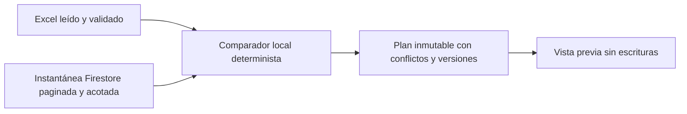

# CLISA — Paso 1.5: auditoría y preparación de la importación

Fecha: 21 de octubre de 2026. Proyecto: `empresa-clisa`.

**Resultado:** el backend real pudo inspeccionarse con consultas limitadas. El paso 2 puede diseñarse como comparación y vista previa de solo lectura. La aplicación de una sincronización todavía tiene bloqueos de reglas, identidad de productos/series, calidad del Excel y atomicidad a gran escala. No se implementó el paso 2 ni se efectuaron escrituras de datos, cambios de roles, despliegues o modificaciones del frontend.

## 1. Conexión, configuración y alcance comprobado

- Firebase CLI **15.34.0**, autenticado; `projects:list` incluye `empresa-clisa`.
- `app/google-services.json`: `project_id = empresa-clisa`, número `700988847796`; app Android `com.example.app_clisa`.
- Base `(default)`, Firestore Native, edición Standard, ubicación `nam5`.
- Metadatos: `freeTier = true`; Cloud Billing: `billingEnabled = false`. No se habilitó facturación.
- No se encontraron `firebase.json`, `.firebaserc` ni un `firestore.rules` en la raíz. Las propuestas de `security/` no son una configuración CLI de despliegue.
- Las consultas CLI utilizaron `--project empresa-clisa`; el helper tiene el mismo destino explícito. No hay alias local persistente que deba darse por supuesto.
- Se descargó la versión actualmente liberada de reglas: `fa1be2b3-bfde-47d1-8758-a4ef1c43cf91`. Su contenido coincide con `security/firestore-user-signup.proposed.rules` al normalizar saltos de línea y espacios exteriores, SHA-256 `45f9f43640e970f740abfa7588ddbc8dd9b9720720f7da7d620d8481cacd063c`.
- El índice compuesto de `productos` con `categoriaId ASC`, `stock ASC`, `__name__ ASC` aparece en la consulta oficial de CLI.

La auditoría utilizó la sesión OAuth existente de CLI, sin Admin SDK, cuentas de servicio, claves exportadas ni usuarios de prueba. Las muestras de datos se autorizaron por **IAM**, como inspección del propietario del proyecto; **no se usaron para simular ni certificar permisos de un usuario Android**. No se ejecutó ninguna escritura de prueba. Las pruebas reales de reglas con identidades USER/ADMIN/SUPER_ADMIN quedan para Emulator Suite.

Se pidieron páginas de hasta tres documentos por colección, se siguieron referencias puntuales y se ejecutaron cuatro consultas pequeñas de igualdad con límites de 2, 3 o 5. En total se devolvieron **31 documentos contando lecturas repetidas**, no un volcado de las colecciones. Dos agregaciones COUNT devolvieron **1 799 productos** y **22 762 existencias** sin descargar sus documentos. No se midió el consumo diario total del proyecto.

La consulta REST inicial de índices devolvió `400 INVALID_ARGUMENT`; se resolvió utilizando `firebase firestore:indexes`, sin cambiar identidad ni permisos. Las inspecciones de datos y metadatos restantes terminaron con HTTP 200. No se sustituyó ningún archivo de configuración existente.

## 2. Estructura real observada

Los tipos se describen como tipos de Firestore, no como su representación JSON REST. Las muestras no demuestran que todos los documentos tengan exactamente los mismos campos.

| Colección | Campos y tipos observados | Identidad y relaciones |
|---|---|---|
| `productos` | Texto: `codigo`, `nombre`, `nombreCompleto`, `descripcion`, `categoriaId`, `marcaId`, `estado`. Enteros: `stock`, `cantidadTotal`, `cantidadRestante`, `cantidadLotes`. Timestamp: `actualizadoEn`. En uno aparece además `ESTADO`; en el producto de una salida aparece `ultimaSalidaId`. | El ID puede coincidir con el SKU, pero no siempre. `categoriaId` y `marcaId` apuntan a documentos de sus catálogos. No apareció `creadoEn` en estos productos muestreados. |
| `existencias` | Texto: `productoId`, `codigoProducto`, `codigo`, `nombreProducto`, `estado`. Enteros: `cantidad`, `filaOrigen`. Timestamp: `actualizadoEn`. Puede existir `ultimaSalidaId`. | IDs compuestos, por ejemplo `0-761345-10024-3_242100661_ec0c340b7e1f07`. **La serie es `codigo`, no ese ID compuesto.** |
| `registros` | Texto: IDs, códigos y nombres históricos, `tipo`, `estado`, `recibidoPor`, `estadoPago`; entero `cantidad`; timestamp `fechaHora`. | Se devolvió una SALIDA COMPLETADO hacia TOQEN, cantidad 1, pago Pendiente. Conserva `productoId` y `existenciaId` reales. No se modificó. |
| `importaciones` | La consulta no devolvió documentos. | No hay un documento real del que certificar el esquema. El contrato que existe es el de las reglas. Firestore no conserva colecciones vacías como entidades independientes. |
| `categorias` | `nombre`: texto; `activo`: booleano. | Ejemplo verificado: `cases-y-gabinetes`, activo, nombre “Cases y gabinetes”. |
| `marcas` | `nombre`: texto; `activo`: booleano. | Ejemplo verificado: `antec`, activo, nombre “Antec”. |
| `usuarios` | `uid`, `email`, `displayName`, `role`, `estado`; opcionales `username`, `profileImageUri`; timestamps `creadoEn` y/o `actualizadoEn`. | Documento vinculado a UID de Auth. Las tres muestras son USER bloqueado, ADMIN bloqueado y SUPER_ADMIN activo. Se ocultaron nombres, correos y UIDs en la evidencia. No se consultaron sus custom claims individuales. |
| `tiendas` | `nombre`, `tipo`, `estado`: texto; `actualizadoEn`: timestamp. | `clisa`: ORIGEN/ACTIVA; `toqen`: RECEPTORA/ACTIVA. |

### Correspondencias que cambian el diseño

1. En las existencias revisadas, `productoId` identifica el **documento** del producto, mientras que `codigoProducto` guarda el **SKU original**. La app ya consulta las existencias por `productoId`.
2. Caso real: `productos/SFYRS_1000G` tiene `codigo = SFYRS/1000G`. Una existencia de `DTX/64GB` usa `productoId = DTX_64GB` y `codigoProducto = DTX/64GB`. No debe inventarse una conversión reemplazando `/` por `_`: podría colisionar con un SKU que ya contiene `_`. Resolver primero por `productos.codigo`, conservando el ID existente.
3. Caso comprobado: el producto `0-761345-10024-3` tiene `stock = 2`, y su consulta limitada devuelve dos existencias de cantidad 1; esa muestra concilia. No se calculó el stock global de toda la base.
4. El producto histórico `83K100KFLM` tiene `stock = 0`, `cantidadRestante = 1`, `cantidadTotal = 1`, `cantidadLotes = 6`. La existencia `SPF5QD453` tiene cantidad 0, SIN_STOCK, y el mismo `ultimaSalidaId` del historial. Android descuenta `stock` y `existencias.cantidad`, pero no los otros contadores. Debe definirse qué representan estos antes de sincronizarlos: no asumir que los cuatro son intercambiables.
5. `ACC00009730` devuelve dos documentos de existencia del mismo producto. `ACC00031673` devuelve dos documentos vinculados a productos diferentes. **El backend real no garantiza unicidad global de `existencias.codigo`.** El escaneo actual detecta más de una coincidencia y rechaza la ambigüedad.
6. La fila negativa de `ACC00009730` del Excel corresponde en las muestras actuales a una existencia con cantidad 0. No se puede devolver automáticamente la cantidad -1 al backend por dar prioridad al Excel.

## 3. Permisos efectivos según las reglas desplegadas

Es análisis del código desplegado; no una prueba de escrituras en producción. Toda operación protegida exige perfil ACTIVO y rol de perfil igual al rol efectivo del token. USER sin claim `role` es el acceso básico, siempre que no tenga claims administrativos incompletos. ADMIN necesita `role=ADMIN, admin=true`. SUPER_ADMIN necesita `role=SUPER_ADMIN, admin=true, superAdmin=true`.

| Operación | USER activo | ADMIN activo | SUPER_ADMIN activo |
|---|---|---|---|
| Leer productos y existencias | Sí | Sí | Sí |
| Leer categorías, marcas, tiendas e historial | Sí | Sí | Sí |
| Crear producto | No | Sí, esquema limitado y stock inicial 0 | Igual que ADMIN |
| Editar producto descriptivamente | No | Solo `nombre`, `estado`, `actualizadoEn` | Igual que ADMIN |
| Actualizar `categoriaId`, `marcaId`, `descripcion` | No | No por la vía actual de edición | No por la vía actual de edición |
| Crear existencia | No | Sí, sin validación suficiente de su estructura | Igual que ADMIN |
| Actualizar stock/existencia | Vía SALIDA; ver fallos de validación | SALIDA o AJUSTE; ver fallos | Igual que ADMIN |
| Eliminar existencia físicamente | No | No | No |
| Crear resumen de importación | No | Sí, si cumple `importacionValida` | Sí |
| Modificar/eliminar historial o resumen de importación | No | No | No |
| Leer perfil propio | Sí, incluso bloqueado para diagnosticar el acceso | Igual | Igual |
| Listar usuarios / cambiar estado de otros USER/ADMIN | No | No | Sí, con protección de cuenta propia y SUPER_ADMIN |
| Cambiar roles desde Android | No | No | No por las reglas actuales |

Un perfil bloqueado puede leer su propio documento, pero no supera `cuentaActiva()` para inventario. Que USER pueda leer productos no le da acceso visual a Gestión de Productos: esas lecturas también son necesarias para Registrar y Escanear. Las reglas no distinguen la pantalla que origina una consulta.

## 4. Bloqueos y riesgos en las reglas desplegadas

Referencias: copia descargada `deployed-0-firestore.rules`; comprobación de listas en `static-findings.json`.

| Prioridad | Hallazgo | Ubicación |
|---|---|---|
| Bloqueante | SALIDA valida `r.estadoPago`, pero `hasOnly()` no lo admite. Enviarlo se rechaza y omitirlo tampoco satisface la validación. El historial existente es anterior al despliegue actual y no prueba que hoy pueda guardarse otra salida. | `registroSalidaValido`, líneas 580–740, especialmente 658 y 678. |
| Bloqueante | AJUSTE exige `recibidoPor` y `estadoPago` en `hasAll()` y los prohíbe en `hasOnly()`. Ningún registro puede satisfacer ambas listas. | `registroAjusteValido`, líneas 878–965. |
| Bloqueante | Nuevos productos solo admiten seis campos: no permiten los campos de clasificación ni los contadores que ya tienen los productos reales. Además se exige `creadoEn`, ausente en las muestras históricas. No reemplazar los documentos existentes con ese esquema mínimo. | `nuevoProductoValido`, línea 287. |
| Bloqueante | La edición no permite actualizar categoría, marca, descripción, nombre completo ni los contadores importados. | `edicionProductoValida`, línea 331. |
| Bloqueante para borrado físico | Las existencias no pueden eliminarse. Retirar de las activas debe definirse como baja lógica compatible y auditada; el historial conserva referencias a los documentos. | `match /existencias`, líneas 400–420. |
| Alto | Crear una existencia solo exige cuenta activa y esAdmin: faltan esquema, tipos, cantidad no negativa, referencia válida y coherencia con el stock. | `allow create`, líneas 404–405. |
| Alto | `getAfter(registro)` no exige que ese registro sea nuevo. Los helpers no excluyen explícitamente la reutilización de un registro antiguo, ni prueban por sí solos que todos los cambios relacionados ocurran de nuevo en la misma operación. Riesgo deducido del código: reproducir y corregir en emulador, no en producción. | Helpers de SALIDA, líneas 452 y 502; AJUSTE, líneas 748 y 805. |
| Alto | El resumen de importación se crea directamente COMPLETADO y después es inmutable. Sus contadores se validan entre sí, pero no se prueba que cada fila anunciada se haya aplicado. Falta contrato de ejecución, reanudación y errores parciales. | `importacionValida`, línea 10; `/importaciones`, línea 1125. |

No se corrigió ni desplegó ninguno de estos bloques durante la auditoría. La futura propuesta debe separar el esquema de SALIDA del de AJUSTE/IMPORTACION, conservar validaciones de stock y exigir coherencia en ambos documentos con un movimiento nuevo e idempotente.

## 5. Excel real y límites de identidad

Archivo revisado en la etapa anterior: `C:/Users/TUF/Documents/stock.production.lot123 - 2000.xlsx`, hoja `stock.production.lot`, rango `A1:F24577`.

- 1 814 grupos, 1 453 códigos de producto distintos, 346 grupos sin SKU, 22 762 filas de series.
- A contiene encabezados `[SKU] Nombre (n)` o la serie individual. C confirma el producto de cada detalle; B está vacía. D es Cantidad; E es Creado en y F es Remaining Qty.
- El sufijo `(n)` cuenta filas, no unidades. Los resúmenes no se suman al detalle.
- El lector conserva corchetes internos, ceros, espacios y los valores anómalos para revisión. No genera SKU para los grupos sin referencia y no mezcla grupos con SKU repetido.
- Hay 567 incidencias: 346 grupos sin código, 15 repeticiones adicionales de códigos de producto, 48 repeticiones adicionales de series tras comparar sin espacios externos, 156 series con espacios y dos cantidades negativas. Las categorías de incidencia pueden coincidir en una misma fila.
- D y F difieren en 80 filas. El contrato solicitado usa D; no sustituirlo silenciosamente por F ni tratarlo como stock aprobado mientras hay errores.
- Firestore devuelve 22 762 existencias, el mismo número de filas de detalle del Excel. **Eso no demuestra que coincidan las series ni sus cantidades.** La comparación por identidad sigue siendo necesaria.

Un archivo con SKU ausentes o ambiguos no debe transformarse en un conjunto incompleto de claves y usarse después para retirar masivamente lo que quedó fuera de ese conjunto. Las series ambiguas existentes en Firestore también deben bloquear una decisión automática, no resolverse tomando el primer documento.

## 6. Cambios que necesitaría el backend, sin implementarlos

1. Acordar el contrato de SKU ↔ documentId y de `productoId` ↔ `codigoProducto`. Conservar IDs existentes; detectar colisiones al crear nuevos. `codigo` de existencia sigue siendo la serie, no su documentId.
2. Corregir las contradicciones de SALIDA y AJUSTE y cubrir creación/actualización de existencias con validaciones completas. Evitar reaplicar un movimiento ya existente. Mantener inventario e historial coherentes en cada unidad atómica.
3. Ampliar de forma explícita las listas de campos administrativos y validar tipos, categorías/marcas activas y referencias. Clasificación solo puede editar campos autorizados: nunca stock, códigos o roles. No integrar IA en esta etapa.
4. Definir la semántica de `stock`, `cantidadTotal`, `cantidadRestante` y `cantidadLotes`. Cantidad de filas/series no equivale a suma de cantidades; una fila de cantidad 0 se conserva como identidad, pero no como stock disponible.
5. Para ausentes del Excel completo, proponer una baja lógica de la existencia conservando su ID y el historial. Una opción compatible con los estados actuales es cantidad 0/SIN_STOCK, pero necesita su operación y reglas aprobadas; no es un cambio autorizado ahora. Productos completamente ausentes van a revisión, no a borrado automático.
6. Diseñar un documento de ejecución/auditoría con hash del archivo, alcance y fecha de corte, versión base, iniciador, decisiones, progreso, errores y estado final. Un resumen COMPLETADO debe corresponder a cambios realmente confirmados. Los campos nuevos y su política de actualización requieren propuesta de esquema y reglas antes de agregarlos.

## 7. Arquitectura y atomicidad recomendadas

Para **el paso 2**, mantener una arquitectura local de solo lectura:

Separar el lector actual, un repositorio de lectura y el comparador puro. El plan debe distinguir: sin cambio, producto nuevo, serie nueva, cantidad diferente, serie a retirar de activas, producto ausente y conflicto. Los SKU, series y nombres ambiguos no se corrigen con IA. La IA futura sería solo una ayuda de clasificación, después de reglas programadas y validación de identidad.

Para **una aplicación futura**, no prometer atomicidad de todo el Excel en un commit. Con 22 762 existencias no es viable tratar la colección completa como una transacción única; hay límites de tamaño, tiempo y evaluaciones de reglas. Una transacción por producto puede mantener su stock y existencias consistentes, pero un trabajo por lotes puede quedar parcialmente completado como conjunto.

Si se exige que nunca se observe una importación parcial de todo el archivo, será necesario aprobar otro diseño: staging/versionado con publicación de una versión completa, o mantenimiento exclusivo con ejecución reanudable y sin exposición de estados intermedios. El primero cambia esquema y lecturas; el segundo no vuelve físicamente atómicas todas las escrituras y debe gestionar fallos y recuperación. Ambos requieren más trabajo que añadir un botón o un batch.

Hay productos con muchas series: incluso una unidad por producto debe comprobar tamaño y límites de llamadas de reglas. No dividir un producto grande en varios commits y declararlo atómico. Diseñar staging o un proceso privilegiado con validaciones propias si el grupo excede los límites, antes de autorizar esa vía.

Límites concretos que debe presupuestar esa etapa: solicitud de hasta 10 MiB; transacción de hasta 270 segundos, con expiración por inactividad de 60 segundos; reglas con hasta 10 accesos documentales por operación individual y 20 por transacción o lote, además del límite individual. El acceso a documentos comunes puede beneficiarse de caché de evaluación, pero no debe suponerse que un número fijo de filas entra en cualquier lote.

La vista previa debe guardar la versión leída. Antes de aplicar, revalidar versiones, permisos y alcance; si hay una salida desde que se leyó el Excel, el plan puede haber quedado obsoleto. Dar prioridad al Excel no implica descontar otra vez todas las salidas históricas ni reactivar una serie transferida sin mostrar ese efecto.

Desplegar Cloud Functions for Firebase requiere Blaze. No se habilitó ni se propone asumir que existe un backend desplegado fuera del repositorio. Mantener Spark es compatible con comparación local y escritura cliente estrictamente validada, pero no elimina los límites de operaciones ni resuelve por sí solo el problema de atomicidad global.

## 8. Spark, consumo y protección contra archivos incompletos

- Los totales actuales suman **24 561 documentos**. Una futura lectura completa y única de ambos inventarios tiene aproximadamente ese número de lecturas, más validaciones y concurrencia. Detectar todas las series ausentes requiere conocer el conjunto completo dentro del alcance: solo buscar los códigos presentes en Excel no descubre los ausentes.
- Usar paginación y caché de una única instantánea por comparación. No listeners globales, ni consultas por pulsación o nuevas lecturas por cada recomposición. No se pueden descartar de la instantánea campos o estados necesarios para identificar conflictos y bajas.
- Spark ofrece 50 000 lecturas, 20 000 escrituras y 20 000 eliminaciones por día. Una pasada que actualizase las 22 762 existencias ya excedería las escrituras diarias, incluso antes de tocar productos o crear auditoría. Es un escenario, no la cantidad de cambios realmente encontrada: todavía no se ejecutó la comparación.
- Escribir solo diferencias y estimar el coste del plan antes de aplicarlo; añadir movimientos por cada cambio incrementa las escrituras. El consumo diario disponible no se consultó, así que no puede garantizarse que el proyecto tenga cuota suficiente.
- Identificar el archivo por hash, validar todas las hojas/columnas, errores, alcance de origen y fecha de corte. Un nombre de archivo o que coincida el número de filas no certifica que el reporte sea completo. Exigir revisión explícita de bajas, de desapariciones masivas y de productos sin código. No decidir un umbral arbitrario de borrado que sustituya la validación de alcance.
- No suprimir ni modificar registros de TOQEN. Las bajas de inventario propuestas no deben eliminar los documentos referenciados por el historial. El inventario muestreado no tiene `tiendaId`; confirmar el alcance CLISA antes de aplicar bajas a toda la colección.
- Restringir toda aplicación futura de importaciones a ADMIN/SUPER_ADMIN activos tanto en Android como en reglas o backend. La sesión de consola de esta auditoría nunca debe convertirse en credenciales incluidas en el APK.

Fuentes oficiales: [cuotas](https://firebase.google.com/docs/firestore/quotas), [precios y agregaciones](https://firebase.google.com/docs/firestore/pricing), [transacciones y límites de reglas](https://firebase.google.com/docs/firestore/manage-data/transactions), [OAuth/IAM frente a ID tokens de Firebase](https://firebase.google.com/docs/firestore/use-rest-api), [requisito Blaze de Functions](https://firebase.google.com/docs/functions/get-started).

## 9. Archivos y plan concreto del paso 2

Archivos actuales a reutilizar: `data/excel/ExcelInventory.kt`, `XlsxInventoryReader.kt`, `ui/products/ExcelImportAction.kt`, `data/AccessPolicy.kt`, `data/FirestoreAccess.kt`. `FirestoreInventory.kt` es el contrato actual de salidas: conservarlo y tenerlo en cuenta para concurrencia. No modificar Detalle de Producto.

Archivos previstos, todavía no creados: modelos del plan de comparación; repositorio paginado de lectura de inventario; comparador puro; estado/ViewModel del flujo; vista previa; pruebas del comparador. Una configuración CLI local y un ruleset versionado deberán prepararse aparte y sin reemplazos automáticos. Las reglas de aplicación futura deben partir del ruleset descargado en esta auditoría, no de una plantilla genérica.

Secuencia propuesta:

1. Fijar y aprobar el contrato de identidades, normalización y campos de cantidades; bloquear conflictos de SKU, series, cantidades negativas y grupos sin referencia. No convertir `SIN-CODIGO` o un nombre en un nuevo ID sin una decisión trazable.
2. Crear pruebas locales del comparador con altas, cambios, ausencias, duplicados, ceros, barras en SKU y cambios concurrentes. No utilizar datos ni usuarios de prueba en producción.
3. Diseñar la instantánea paginada, con límites y progreso. Verificar el acceso de lectura con identidades de app mediante Emulator Suite; no dar por validado un rol porque IAM puede leer.
4. Comparar series por identidad y producto; conservar documentId, SKU y versión. Detectar ambigüedad en ambos lados. No mezclar grupos diferentes por compartir SKU ni dar por iguales dos inventarios solo porque coincide su stock total.
5. Mostrar una vista previa exclusivamente de lectura, con causas, conflictos, productos ausentes y coste estimado. Mientras no se haya completado el alcance de lectura, no declarar definitiva la lista de ausentes.
6. Revalidar reglas en emulador y documentar qué permisos/índices realmente necesita la comparación. No desplegar aún las reglas para escribir importaciones: el paso 2 no escribe.
7. Diseñar y aprobar por separado la etapa de aplicación, la atomicidad que se garantiza y su compatibilidad real con Spark. Solo después podrán autorizarse cambios de inventario.

### Evidencias y límites de la entrega

Se añadieron únicamente archivos bajo `security/audit-2026-10-21/`: este informe, la copia desplegada, los resultados de metadatos, muestras con datos personales ocultos, relaciones, cantidades globales, índices, incidencias estáticas y dos helpers de auditoría. No se tocaron código Android, reglas propuestas previas ni configuración raíz.

No se ejecutaron pruebas con escrituras contra Firestore, pruebas de permisos Android en vivo, emulador de reglas, un inventario completo por documentos, clasificación ni sincronización. No se inspeccionaron todos los usuarios de Auth ni sus claims. Las conclusiones estructurales se limitan a los documentos muestreados; los totales sí provienen de COUNT. No se vuelve a compilar Android porque esta etapa no cambió su código.
